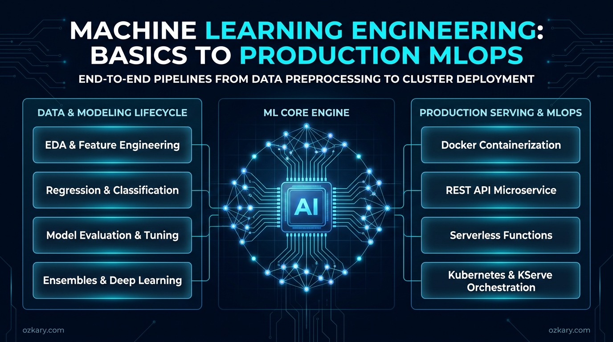
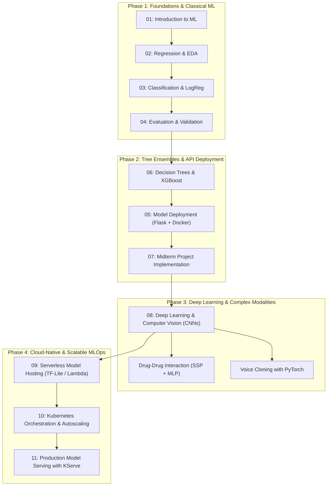
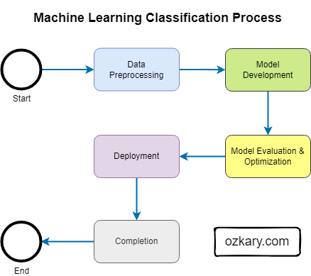

# Machine Learning Engineering: From Basics to Production MLOps

Welcome to the **Machine Learning Engineering** repository—a structured, comprehensive collection of resources, source code, interactive notebooks, and production deployment patterns designed to teach machine learning from first principles to scalable real-world architectures.

Whether you are beginning your data science journey or mastering production engineering (MLOps), this repository guides you through algorithmic foundations, deep learning, containerization, serverless functions, and Kubernetes orchestration.



---

## Table of Contents

- [Overview](#overview)
- [Video Lectures & Walkthroughs](#video-lectures--walkthroughs)
- [Featured on Kaggle](#featured-on-kaggle)
- [Learning Roadmap](#learning-roadmap)
- [Curriculum & Module Index](#curriculum--module-index)
- [Featured Capstone Projects](#featured-capstone-projects)
- [Model Selection Guide](#model-selection-guide)
- [Getting Started](#getting-started)
- [Related Articles & Deep Dives](#related-articles--deep-dives)
- [Community & Updates](#community--updates)
- [Contributing](#contributing)
- [License](#license)

---

## Overview

Machine learning transforms data into predictive intelligence and automated decision systems. This repository functions both as an academic syllabus and a practical engineering playbook:

- **Mathematical Foundations & EDA**: Understand linear models, cost functions, loss minimization, and data preprocessing.
- **Supervised Learning**: Master classification and regression with classical algorithms and ensemble tree methods (XGBoost, Random Forests).
- **Validation & Metrics**: Rigorously evaluate models with precision-recall curves, ROC-AUC, confusion matrices, and cross-validation.
- **Deep Learning & Computer Vision**: Build convolutional neural networks (CNNs) and apply transfer learning with TensorFlow/Keras and PyTorch.
- **Cloud-Native MLOps**: Containerize models with Docker, serve REST inference APIs with Flask/Gunicorn, deploy serverless functions, and scale with Kubernetes and KServe.

---

## Video Lectures & Walkthroughs

Accelerate your learning with video lectures and technical walkthroughs corresponding to the curriculum:

| 📺 Discovering Machine Learning: A Primer Guide | 🎓 Neural Network Model Analysis (Harvard CS50 AI) | 📺 AI Agents for Health Risk Assessment (Kaggle) |
| :---: | :---: | :---: |
| [](https://www.youtube.com/live/ZJDyXNuHrfE?si=wxmU4sgTXlJGq1QZ) | [](https://youtu.be/OJjZGb7fmOo?si=3S3ip92ZNSdjUFAY) | [](https://youtu.be/6YrRqS8zA00?si=dbadR7FDY8tqIcCB) |
| [Watch Live Stream](https://www.youtube.com/live/ZJDyXNuHrfE?si=wxmU4sgTXlJGq1QZ) | [Watch Deep Dive](https://youtu.be/OJjZGb7fmOo?si=3S3ip92ZNSdjUFAY) | [Watch Walkthrough](https://youtu.be/6YrRqS8zA00?si=dbadR7FDY8tqIcCB) |
| **Topics:** ML definitions, supervised vs. unsupervised paradigms, problem formulation, exploratory data analysis (EDA), data cleaning, feature engineering, and lifecycle. | **🎓 Created for [Harvard CS50 AI](https://pll.harvard.edu/course/cs50s-introduction-artificial-intelligence-python):** In-depth breakdown of CNN layer architectures, activation functions, convolutional kernels, pooling, and image classification convergence. | **Topics:** Clinical interview AI agent on Google Cloud Run, MCP tools integration, real-time risk score inference, and personalized health recommendations. |

---

## Featured on Kaggle

> 🏆 **Kaggle VibeCoding Agents Capstone Project:**  
> The work developed in this repository's [Heart Disease Risk Assessment](./projects/heart-disease-risk/README.md) project has been featured on Kaggle!  
>  
> - 📄 **Read the Writeup:** [AI Agents for Health Risk Assessment on Kaggle](https://www.kaggle.com/competitions/vibecoding-agents-capstone-project/writeups/ai-agents-for-health-risk-assessment)  
> - 📺 **Watch the Video Demo:** [AI Agents for Health Risk Assessment Walkthrough](https://youtu.be/6YrRqS8zA00?si=dbadR7FDY8tqIcCB)  
>  
> Learn how to take a trained tabular machine learning classifier and integrate it into an agentic workflow using the Model Context Protocol (MCP), Gemini (Vertex AI), and Google Cloud Run for conversational healthcare risk assessment.

---

## Learning Roadmap

Follow this progression path to transition from core fundamentals to scalable cloud architectures:



---

## Curriculum & Module Index

Each numbered module contains in-depth documentation, runnable Jupyter notebooks, and production code:

| Module | Title & Documentation | Core Topics Covered | Practical Code & Notebooks |
| :---: | :--- | :--- | :--- |
| **01** | [01-Introduction](./01-introduction/README.md) | What is ML, Core concepts, Supervised learning principles, $Data + Outcome \to Model$, Generalization | [homework.ipynb](./01-introduction/homework.ipynb), [comparison.ipynb](./01-introduction/comparison.ipynb) |
| **02** | [02-Regression](./02-regression/README.md) | Linear regression, normal equation, exploratory data analysis (EDA), feature engineering, validation split, RMSE | [homework.ipynb](./02-regression/homework.ipynb) |
| **03** | [03-Classification](./03-classification/README.md) | Binary/multi-class classification, Logistic Regression, Sigmoid function, mutual information, one-hot encoding | [homework.ipynb](./03-classification/homework.ipynb) |
| **04** | [04-Evaluation](./04-evaluation/README.md) | Confusion matrix, Accuracy, Precision, Recall, F1 score, ROC and PR curves, AUC, K-Fold cross-validation | [homework.ipynb](./04-evaluation/homework.ipynb) |
| **05** | [05-Deployment](./05-deployment/README.md) | Serializing models (Pickle/Joblib), building web services with Flask/Gunicorn, Pipenv dependencies, Docker containers | [app.py](./05-deployment/app.py), [Dockerfile](./05-deployment/Dockerfile), [homework.ipynb](./05-deployment/homework.ipynb) |
| **06** | [06-Trees & Ensembles](./06-trees/README.md) | Decision Trees, stopping criteria, Random Forests, Gradient Boosting (XGBoost), hyperparameter tuning | [homework.ipynb](./06-trees/homework.ipynb) |
| **07** | [07-Midterm Project](./07-midterm-project/README.md) | End-to-end capstone methodology: Problem statement, data preparation, model selection, tuning, and API serving | [README.md](./07-midterm-project/README.md) |
| **08** | [08-Deep Learning](./08-deep-learning/README.md) | Artificial neural networks, Convolutional Neural Networks (CNNs), TensorFlow/Keras, image augmentation, transfer learning *(includes lecture for [Harvard CS50 AI](https://pll.harvard.edu/course/cs50s-introduction-artificial-intelligence-python))* | [homework.ipynb](./08-deep-learning/homework.ipynb) |
| **09** | [09-Serverless Hosting](./09-serverless/README.md) | Serverless inference on AWS Lambda / Azure Functions, converting models to TensorFlow-Lite, Docker runtime optimization | [main.py](./09-serverless/main.py), [Dockerfile](./09-serverless/Dockerfile), [homework.ipynb](./09-serverless/homework.ipynb) |
| **10** | [10-Kubernetes](./10-kubernetes/README.md) | Container orchestration with K8s, Deployments, Services, Horizontal Pod Autoscaler (HPA), Kind/Minikube local clusters | [deployment.yaml](./10-kubernetes/src/deployment.yaml), [hpa.yaml](./10-kubernetes/src/hpa.yaml), [q4_predict.py](./10-kubernetes/src/q4_predict.py) |
| **11** | [11-KServe](./11-kserve/README.md) | Cloud-native model serving with KServe, automated GPU/CPU scaling, multi-framework support (TF, PyTorch, ONNX), vLLM | [quick_install.sh](./11-kserve/quick_install.sh), [iris_example.yaml](./11-kserve/iris_example.yaml) |

---

## Featured Capstone Projects

Explore end-to-end case studies implementing machine learning architectures for real-world problems:

### 1. [Heart Disease Risk Assessment](./projects/heart-disease-risk/README.md) *(Featured on Kaggle & ozkary.com)*
* **Domain:** Healthcare & Preventative Medicine
* **Dataset:** US Centers for Disease Control and Prevention (CDC) EHR data
* **Architecture:** Implements a Model Factory pattern comparing Logistic Regression and Random Forest classifiers, complete with data preprocessing pipelines and containerized REST endpoints.
* **Publications & Capstone Extension:** 
  - [Technical Blog Post: A Learning-Based Approach for Predicting Heart Disease](https://www.ozkary.com/2023/12/ai-learning-based-approach-predicting-heart-disease.html)
  - [Kaggle Writeup: AI Agents for Health Risk Assessment](https://www.kaggle.com/competitions/vibecoding-agents-capstone-project/writeups/ai-agents-for-health-risk-assessment)
  - [Video Demo: AI Agents for Health Risk Assessment Walkthrough](https://youtu.be/6YrRqS8zA00?si=dbadR7FDY8tqIcCB)
* **Key Assets:** [README.md](./projects/heart-disease-risk/README.md), [data_train.py](./projects/heart-disease-risk/data_train.py), [app.py](./projects/heart-disease-risk/app.py), [Dockerfile](./projects/heart-disease-risk/Dockerfile)

### 2. [Drug-to-Drug Interaction (DDI) Classifier](./projects/drug-drug-interaction/README.md)
* **Domain:** Pharmacogenomics & Computational Chemistry
* **Dataset:** DrugBank repository of over 190,000 known drug interaction pairs
* **Architecture:** Formulates DDI prediction by extracting SMILES molecular representations, generating Structural Similarity Profile (SSP) vectors, and training Multi-Layer Perceptrons (MLP) for multi-label interaction prediction.
* **Key Assets:** [README.md](./projects/drug-drug-interaction/README.md), [data_train_mlp.ipynb](./projects/drug-drug-interaction/data_train_mlp.ipynb), [app.py](./projects/drug-drug-interaction/app.py), [Dockerfile](./projects/drug-drug-interaction/Dockerfile)

### 3. [Deep Learning Voice Cloning with PyTorch](./voice-cloning/README.md)
* **Domain:** Speech Processing & Generative Audio
* **Architecture:** Audio spectrogram feature extraction, acoustic modeling, neural vocoder pipelines, and PyTorch deep learning implementations.
* **Key Assets:** [README.md](./voice-cloning/README.md)

### 4. Additional Exploratory Studies
* **[Vehicle MSRP Price Prediction](./projects/vehicle-msrp/)**: Multivariate regression and feature collinearity analysis for car market valuations ([regression.ipynb](./projects/vehicle-msrp/regression.ipynb)).
* **[End-to-End Census & Demographic Modeling](./projects/census/)**: Socioeconomic classification workflows ([end_to_end_machine_learning_project.ipynb](./projects/census/end_to_end_machine_learning_project.ipynb)).

---

## Model Selection Guide

Selecting the right machine learning algorithm depends on the nature of the target variable, data volume, interpretability requirements, and latency constraints:



| Model Type | Primary Task | Best Suited For | Advantages & Tradeoffs |
| :--- | :--- | :--- | :--- |
| **Linear Regression** | Continuous Prediction | Baseline price forecasting, trend lines | Fast, highly interpretable; vulnerable to non-linearities and outliers. |
| **Ridge / Lasso Regression** | Continuous Prediction | Datasets with multicollinear or high-dimensional features | Regularization prevents overfitting; balances feature weights. |
| **Logistic Regression** | Binary / Multi-class | Disease diagnosis, customer churn probability | Provides calibrated probabilities; linear decision boundary. |
| **Decision Trees** | Classification & Regression | Rules-based workflows, demographic segmentation | Natural handling of non-linearities and categorical data; prone to overfitting. |
| **Random Forests** | Classification & Regression | Defect detection, credit risk, complex tabular data | Ensemble bagging reduces variance; robust against noise. |
| **Gradient Boosting (XGBoost)** | Classification & Regression | Kaggle benchmarks, ranking, fraud detection | State-of-the-art tabular accuracy; requires hyperparameter tuning. |
| **Support Vector Machines (SVM)** | Classification & Regression | Quality control, text classification | Effective in high-dimensional spaces with custom kernels. |
| **K-Nearest Neighbors (KNN)** | Classification & Regression | Equipment maintenance scheduling, recommendation systems | Instance-based / lazy learning; inference slows with large datasets. |
| **Convolutional Neural Networks (CNN)** | Computer Vision | Image recognition, defect inspection, medical scans | Captures spatial hierarchies; requires GPU acceleration and large datasets. |
| **Multi-Layer Perceptrons (MLP)** | Complex Multi-modal | Chemical interaction (DDI), non-linear feature maps | Flexible neural modeling; requires careful regularization. |

---

## Getting Started

### Prerequisites
- **Python**: 3.9 or higher
- **Package / Environment Manager**: `pipenv` or `venv` / `conda`
- **Docker**: For testing containerized models locally

### Quickstart Setup

1. **Clone the repository:**
   ```bash
   git clone https://github.com/ozkary/ml-engineering.git
   cd ml-engineering
   ```

2. **Create a virtual environment and install dependencies:**
   ```bash
   # Using Python venv
   python3 -m venv .venv
   source .venv/bin/activate
   pip install jupyter scikit-learn pandas numpy matplotlib seaborn
   ```
   *Or use `pipenv` inside any module folder (e.g., `cd 05-deployment && pipenv install`).*

3. **Launch Jupyter Lab / Notebooks:**
   ```bash
   jupyter lab
   ```

4. **Detailed Environment & Setup Guide:**
   For step-by-step instructions on setting up Docker, Pipenv, Kubernetes clusters (Kind/Minikube), and testing APIs, read the complete **[Getting Started Guide](./getting_started.md)**.

---

## Related Articles & Deep Dives

Deepen your understanding with technical writeups and architecture articles published on [ozkary.com](https://www.ozkary.com):

- 📖 **[AI Study: A Learning-Based Approach for Predicting Heart Disease](https://www.ozkary.com/2023/12/ai-learning-based-approach-predicting-heart-disease.html)**  
  *Comprehensive evaluation using CDC EHR data, contrasting Logistic Regression, Decision Trees, Random Forests, and XGBoost, with deployment patterns.*
- 📖 **[Discovering Machine Learning: A Primer Guide](https://www.ozkary.com/2025/02/discovering-machine-language-primer-guide.html)**  
  *Companion reading for Module 01 exploring the machine learning lifecycle, supervised vs. unsupervised paradigms, and feature engineering.*
- 📖 **[AI Python TensorFlow Neural Network Analysis](https://www.ozkary.com/2023/10/ai-python-tensorflow-neural-network-analysis.html.html)**  
  *In-depth architectural breakdown of Convolutional Neural Networks (CNNs), convolutional kernels, pooling layers, and feature map visualizations.*

---

## Community & Updates

Stay up-to-date with tutorials, guides, and open-source releases:

- 📬 **Newsletter:** [Sign up for the ML Engineering & AI Newsletter](https://www.ozkary.com/newsletter)
- 🐦 **Twitter / X:** Follow [@ozkary](https://twitter.com/ozkary)
- 🤖 **Companion AI Agents Repo:** [ozkary/ai-engineering](https://github.com/ozkary/ai-engineering)
- 📊 **Companion Data Engineering Repo:** [ozkary/data-engineering-mta-turnstile](https://github.com/ozkary/data-engineering-mta-turnstile)

---

## Contributing

Contributions, issues, and feature suggestions are welcome! Whether it is fixing a typo, proposing a new algorithm notebook, or optimizing a Docker configuration, please review our [Contribution Guidelines](./CONTRIBUTING.md) before submitting a pull request.

---

## License

This repository is distributed under the terms of the [Apache License 2.0](./LICENSE). Feel free to use the code, notebooks, and reference materials in your projects and studies.
